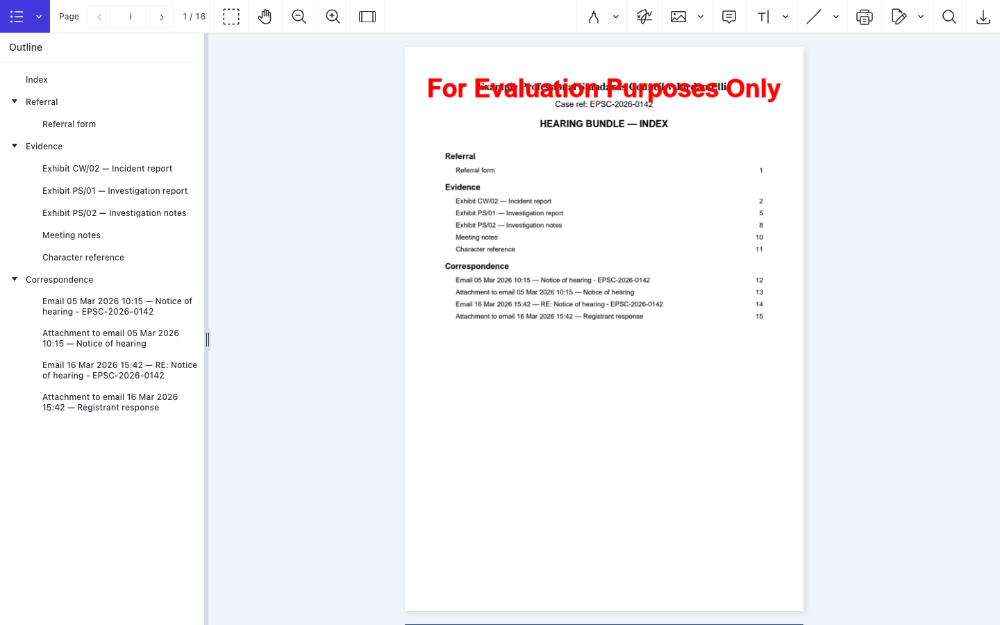
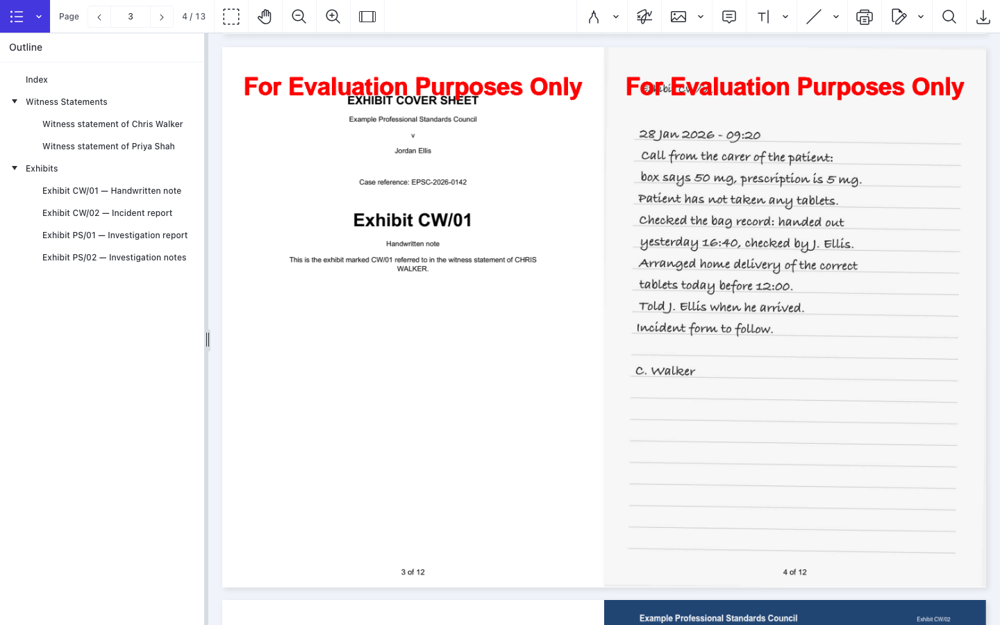
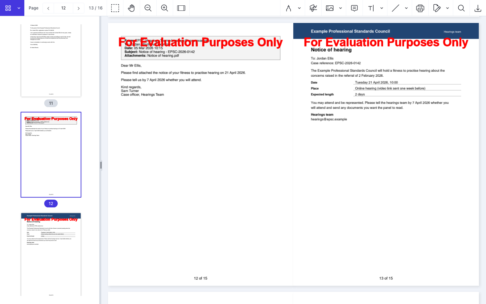

# Nutrient Document Bundling

A Nutrient.io demo that builds one paginated, indexed PDF bundle from a mix of PDFs, Word documents, images and emails, described by a JSON manifest.



1. **Manifest.** A JSON file lists the bundle title, the case title and reference, an optional Word cover sheet template, and the sections with their documents in order. In production it would come from your case management system.
2. **Ingest.** Each email (`.eml` or Outlook `.msg`, read with MsgReader) becomes its own entry, followed by one entry per attachment. The email is rendered to a clean HTML page with From, To, Date, Subject and Attachments, and every date is written in one format (`dd MMM yyyy HH:mm`).
3. **Convert.** GdPicture.API converts every input to PDF: DOCX, DOC, RTF, ODT, XLSX, XLS, PPTX, HTML, TXT, JPEG, PNG, TIFF and BMP. PDFs are copied as they are.
4. **Cover sheets.** For each item with an `exhibitRef`, the Word template is filled in (`[ Defendant name ]`, `[ Case reference ]`, `[ Exhibit ref ]`, `[ Document name ]`, `[ Witness name ]`) and converted to PDF, then placed before the exhibit. Placeholders split over several Word runs are joined first.
5. **Merge and OCR.** All documents are merged. Pages without a text layer (scans, photos) get OCR; pages that already have text are left alone.
6. **Index and navigation.** GdPicture.API adds a table of contents with clickable rows, bookmarks per section and document, page labels (roman numerals for the index, arabic for the body) and "n of N" page numbers.
7. **A4.** Every page is scaled onto A4 portrait, keeping its aspect ratio, so the bundle prints consistently.

Everything runs locally with the GdPicture.API NuGet package. No external service is called.

## Prerequisites

- .NET SDK 10
- macOS, Windows or Linux (the matching `GdPicture.Runtimes.*` package is selected at build time)
- Optional, only to regenerate the samples: Python 3.10 or later

## Environment variables

The app reads its settings from the environment only. `.env.example` lists them.

| Variable | Purpose | Default |
|---|---|---|
| `GDPICTURE_LICENSE_KEY` | GdPicture.API license key | empty = evaluation mode (watermark, 1 hour per run) |
| `GDPICTURE_OCR_PATH` | Folder that contains `eng.traineddata` | empty = the OCR resources in the build output (`GdPicture.Resources` package) |

In evaluation mode GdPicture stamps "For Evaluation Purposes Only" on every page. The OCR step ignores that stamp when it decides whether a page has a text layer.

## Build and run

```bash
dotnet build BundlingPoc
```

```bash
dotnet run --project BundlingPoc -- samples/hearing-bundle/manifest.json
```

```bash
dotnet run --project BundlingPoc -- samples/witness-bundle/manifest.json
```

Each run writes `<bundleTitle>.pdf` next to the manifest, for example `samples/hearing-bundle/Hearing Bundle.pdf`. A second argument sets another output path:

```bash
dotnet run --project BundlingPoc -- samples/hearing-bundle/manifest.json output/hearing-bundle.pdf
```

With a license key:

```bash
cp .env.example .env
```

Set `GDPICTURE_LICENSE_KEY` in `.env`, then:

```bash
set -a && source .env && set +a && dotnet run --project BundlingPoc -- samples/hearing-bundle/manifest.json
```

The console shows each step and the body page where each document starts. Intermediate files are written to a temporary folder (`bundling-poc/<id>` in the system temp folder).

The screenshots show the sample bundles built in evaluation mode, hence the red stamp at the top of each page.

## Usage

### Manifest

```json
{
  "bundleTitle": "Hearing Bundle",
  "caseTitle": "Example Professional Standards Council v Jordan Ellis",
  "caseRef": "EPSC-2026-0142",
  "coverSheetTemplate": "../documents/Exhibit cover sheet template.docx",
  "sections": [
    {
      "title": "Evidence",
      "items": [
        { "file": "../documents/CW02 incident report.pdf", "title": "Incident report", "exhibitRef": "CW/02", "witness": "Chris Walker" },
        { "file": "../documents/Meeting notes.docx", "title": "Meeting notes" }
      ]
    },
    {
      "title": "Correspondence",
      "items": [
        { "file": "../documents/Email - Notice of hearing.eml", "expandAttachments": true }
      ]
    }
  ]
}
```

| Field | Description |
|---|---|
| `bundleTitle` | Title of the index page and default output file name |
| `caseTitle` | Case title on the index. The part after `" v "` fills `[ Defendant name ]` on cover sheets |
| `caseRef` | Case reference on the index and on cover sheets |
| `coverSheetTemplate` | Word template for exhibit cover sheets. Required when an item has `exhibitRef` |
| `sections[].title` | Section heading in the index and in the bookmarks |
| `items[].file` | Path to the document, relative to the manifest or absolute |
| `items[].title` | Title in the index. Default: the file name |
| `items[].exhibitRef` | Exhibit reference, for example `CW/02`. Adds a cover sheet before the document |
| `items[].witness` | Witness whose statement refers to the exhibit, written in capitals on the cover sheet |
| `items[].expandAttachments` | For emails: add each attachment as its own entry after the email. Default `true` |

### Samples

`samples/documents` holds a fictitious case: the regulator, the people, the addresses and the email domains (`.example`) are invented. `scripts/make-samples.py` generates every file in it with reportlab, python-docx and Pillow:

| File | What it tests |
|---|---|
| `Referral form.pdf`, `PS01 investigation report.pdf` | Text PDFs |
| `CW02 incident report.pdf` | US Letter pages, scaled to A4 |
| `PS02 investigation notes.pdf` | A scanned page with no text layer: OCR |
| `CW01 handwritten note.jpg` | A photo of a handwritten note: image conversion and OCR |
| `Meeting notes.docx`, `Character reference.docx`, `Witness statement - *.docx` | Word conversion, a table, bullet lists |
| `Exhibit cover sheet template.docx` | Cover sheet placeholders, one of them split over two runs |
| `Email - Notice of hearing.eml` | HTML email with a PDF attachment |
| `Email - Registrant response.eml` | HTML email with a Word attachment |

`samples/hearing-bundle/manifest.json` builds a hearing bundle in three sections (referral, evidence with exhibits, correspondence). `samples/witness-bundle/manifest.json` builds a witness bundle (statements, then exhibits).

An exhibit cover sheet from the Word template, followed by the photo of the handwritten note (converted and OCRed):



An email rendered with its normalised header block, followed by its PDF attachment:



To generate the samples again, use a virtual environment outside the repository:

```bash
python3 -m venv /tmp/bundling-samples-venv
```

```bash
/tmp/bundling-samples-venv/bin/pip install -r scripts/requirements.txt
```

```bash
/tmp/bundling-samples-venv/bin/python scripts/make-samples.py
```

The handwritten note and the scanned page use a system font when one is found (for example Bradley Hand and Courier New on macOS), so they look slightly different from one machine to another.

## Where to look in the code

- `BundlingPoc/Program.cs`: license, font folders, arguments.
- `BundlingPoc/Models/Manifest.cs`: the manifest model.
- `BundlingPoc/Pipeline/BundleBuilder.cs`: the pipeline (merge, selective OCR, index, bookmarks, links, page labels, page numbers, A4).
- `BundlingPoc/Pipeline/EmailIngestor.cs`: `.eml` and `.msg` expansion and HTML rendering.
- `BundlingPoc/Pipeline/Converter.cs`: conversion to PDF with `GdPictureDocumentConverter`.
- `BundlingPoc/Pipeline/CoverSheet.cs`: cover sheet template merge.

## Notes

- **Fonts:** GdPicture does not scan the macOS and Linux font folders by default. `Program.cs` adds them, otherwise Office and HTML conversion produce PDFs with missing fonts.
- **Email bodies:** the HTML body of an email is reduced to its `<body>` content; `cid:` images and Word conditional comments are removed. When paginated HTML conversion fails, the converter retries with a single page, and the A4 step rescales it.
